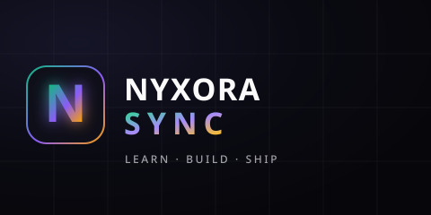

<p align="center">
  
</p>

<h1 align="center">Nyxora Sync</h1>

<p align="center">
  A free, written curriculum for web development and programming languages — from your first program to production mastery.
</p>

<p align="center">
  <a href="https://nyxora-sync.tech/learn"><strong>Start learning →</strong></a>
  &nbsp;·&nbsp;
  <a href="https://nyxora-sync.tech/roadmap">Roadmap</a>
  &nbsp;·&nbsp;
  <a href="https://nyxora-sync.tech/resources">Resources</a>
  &nbsp;·&nbsp;
  <a href="https://nyxora-sync.tech/community">Community</a>
</p>

<p align="center">
  
  
</p>

## Learn directly on the site

Nyxora Sync is built for people who want to learn by reading, practicing, and building — not by assembling a local development environment.

Everything you need is on the live site:

- **194 unique written lessons** across web development, specializations, and programming language paths
- **Free, curated resources** in every lesson, with optional "go deeper" links
- **Interactive playgrounds** for HTML, CSS, JavaScript, React, Node, and Express
- **Progress tracking** with XP, levels, streaks, badges, notes, and bookmarks
- **Verifiable track certificates** with public verification links and print-ready pages
- **Lesson discussions**, a project showcase, public learner profiles, and moderation tools

No paywalls. No ads. No account required to start.

## Choose a path

### Web Development

**Beginner Track** — start from zero:
1. Web Foundations — how the web works, HTML, CSS, JavaScript, the DOM, async, Git, and a portfolio project
2. Node.js & Express — runtime, routing, REST, auth, and testing
3. MongoDB & Mongoose — documents, schemas, relations, and aggregation
4. React — components, hooks, routing, state, forms, and performance
5. Full Stack Mastery — integration, Socket.io, uploads, deployment, and a capstone

**Developer Track** — already know JavaScript?
- Start with the shared MERN core: Node.js & Express, MongoDB, React, and Full Stack Mastery
- Continue into TypeScript, testing, security, DevOps, architecture, performance, and a master capstone

Both tracks share the same four MERN core modules, so you can switch paths without losing progress.

**Specializations** — after the core:
1. Advanced React & Next.js — Server Components, streaming, Cache Components, Server Actions, and production deployment
2. DevOps & Cloud — Kubernetes, a small AWS footprint, Terraform, secrets, and incident response
3. Scalable Systems — service boundaries, distributed data, Redis, reliable queues, and idempotency
4. React Native — Expo, native navigation, secure authentication, offline sync, and store release

### Programming Languages

Four complete paths from beginner to mastery. Each path has three levels (Foundations → Professional → Mastery) and ends with a capstone project.

- **C** — Toolchain, types, pointers, memory, files, concurrency, and an HTTP server capstone
- **C++** — Modern C++, RAII, templates, move semantics, concurrency, performance, and a multithreaded server capstone
- **C#** — .NET toolchain, OOP, LINQ, EF Core, ASP.NET Core, background services, and a production API capstone
- **Python** — Syntax, collections, typing, testing, async, packaging, automation, and a data pipeline capstone

## How progress works

You can use the entire curriculum without signing in. Progress is saved in your browser automatically.

If you want your progress on another device, sign in with GitHub. Your completed lessons, XP, streaks, notes, bookmarks, badges, and certificates sync to your account. You can keep your profile private or make your progress public from Settings. Up to three earned badges can be pinned to your public profile.

## Community

- Ask questions and share notes in lesson discussions
- Browse real projects in the [showcase](https://nyxora-sync.tech/community/showcase)
- Meet other learners through public profiles
- Report bugs, suggest resources, or improve a lesson through the [contribution guide](https://nyxora-sync.tech/contribute)
- Report projects, comments, or profiles from the UI; maintainers review them at `/admin/reports`

## Contributing

Nyxora Sync is open source and welcomes contributions:

- Fix a confusing explanation or a broken link
- Suggest a free resource for a lesson
- Report a bug or an accessibility issue
- Share a project for the showcase
- Help with translations or design improvements

Open a [GitHub issue](https://github.com/Nyxora-Sync/nyxora-sync/issues) or submit a pull request. Read the [contribution guide](https://nyxora-sync.tech/contribute) and [Code of Conduct](https://nyxora-sync.tech/code-of-conduct) first.

## Deployment

Production: https://nyxora-sync.tech

The public URL is served by the custom domain `nyxora-sync.tech` pointing directly to Vercel (bypassing the Cloudflare Worker proxy for POST support). The Next.js app runs on **Vercel** in the `iad1` region, co-located with the Neon database in `us-east-1`.

### App (Vercel)

```bash
npx vercel login
npx vercel link --scope miyazaki-akis-projects --project nyxora-sync
npm run deploy:web
```

The project is `miyazaki-akis-projects/nyxora-sync`. Production builds apply pending Prisma migrations via the Vercel build command, guarded by `VERCEL_ENV=production`; preview builds run `npm run build` without touching the database. The old `postbuild` `prisma db push --accept-data-loss` step has been removed.

Set these environment variables for Production:

- `DATABASE_URL` and `DIRECT_URL` (Neon)
- `AUTH_SECRET`, `AUTH_TRUST_HOST=true`
- `AUTH_URL=https://nyxora-sync.tech`
- `NEXTAUTH_URL=https://nyxora-sync.tech`
- `NEXT_PUBLIC_SITE_URL=https://nyxora-sync.tech`
- `GITHUB_CLIENT_ID`, `GITHUB_CLIENT_SECRET`
- `GOOGLE_CLIENT_ID`, `GOOGLE_CLIENT_SECRET`
- `ADMIN_EMAILS` (comma-separated maintainer emails; gates `/admin/messages`, `/admin/newsletter`, and `/admin/reports`)
- `BLOB_READ_WRITE_TOKEN` (enables project screenshot uploads through Vercel Blob; the `nyxora-uploads` store is connected to Production and Preview. Pull it with `vercel env pull` when testing uploads locally.)

`AUTH_URL`, `NEXTAUTH_URL`, and `NEXT_PUBLIC_SITE_URL` must all be the public origin (`https://nyxora-sync.tech`). The apex domain is the canonical host; `www.nyxora-sync.tech` permanently redirects to it. Vercel is configured for the `iad1` region so functions run next to the Neon database. Disable **Deployment Protection → Vercel Authentication** for production. Connecting the GitHub repository in the Vercel dashboard enables automatic deploys; otherwise run `npm run deploy:web`.

### Health and monitoring

`GET /api/health` checks database connectivity and returns `200` with `{ status: "ok" }` or `503` when degraded. Point an uptime monitor at it. Vercel Speed Insights and function logs cover performance and server errors; set up a Sentry DSN only if you need long-retention client error traces.

### Tests and CI

```bash
npm run typecheck   # TypeScript
npm run lint:ci     # ESLint (warnings allowed, errors fail)
npm test            # Vitest unit tests
npx playwright install chromium
npm run build
npm run test:e2e    # Playwright smoke + mobile overflow checks
```

GitHub Actions runs typecheck, lint, unit tests, a production build, and Playwright against a fresh build. Add `DATABASE_URL` and `DIRECT_URL` repository secrets so database-backed build checks can connect.

### Contact inbox

The floating contact button opens `/contact`. Each submission is stored in the `ContactMessage` table before an email notification is attempted. Maintainers listed in `ADMIN_EMAILS` can read messages, reply by email, and mark them handled at `/admin/messages`. The same page is linked from **Settings → Privacy → Maintainer tools**.

Email notifications are optional. Set `EMAIL_SERVER_*`, `EMAIL_FROM`, and `CONTACT_INBOX` to also receive a copy; without SMTP, the admin inbox is still the source of truth.

### Public URL proxy (Cloudflare)

```bash
npm run deploy:proxy
```

The proxy configuration lives in `proxy-worker/wrangler.jsonc`. Set `UPSTREAM_ORIGIN` there to the Vercel production URL. The proxy has no KV or database bindings; it only forwards HTTP requests and responses.

OAuth callback URLs (set these in the provider consoles):

- GitHub: `https://nyxora-sync.tech/api/auth/callback/github`
- Google: `https://nyxora-sync.tech/api/auth/callback/google`

The old `NEXT_INC_CACHE_KV` namespace is no longer used by the live site. The CI workflow deploys only the proxy; it needs a Cloudflare API token with **Workers Scripts: Edit**.

## License

- **Code:** MIT — see [`LICENSE`](LICENSE)
- **Lesson content:** CC BY-SA 4.0 — see [`LICENSE-CONTENT`](LICENSE-CONTENT)

## Acknowledgements

Resources are curated from freeCodeCamp, MDN, The Odin Project, Full Stack Open, Net Ninja, Traversy Media, Web Dev Simplified, official documentation, and many other generous educators.